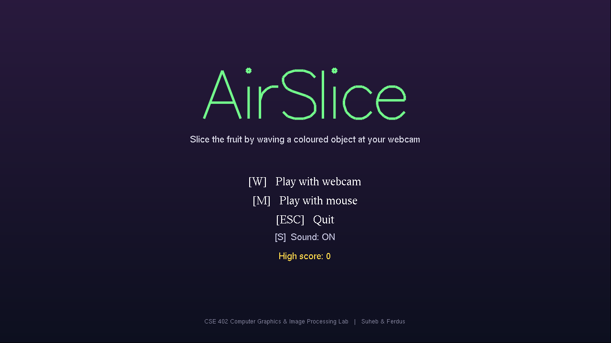
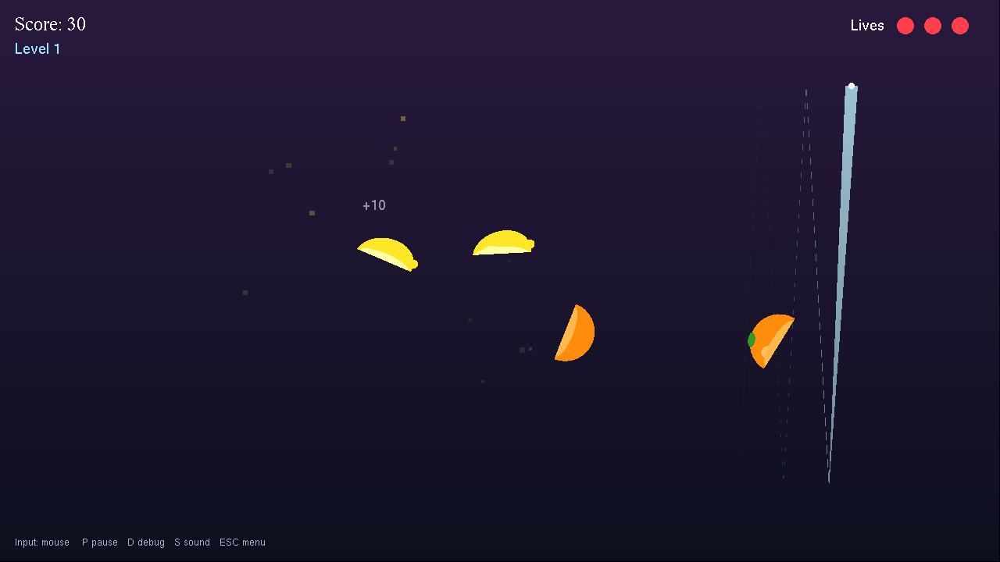
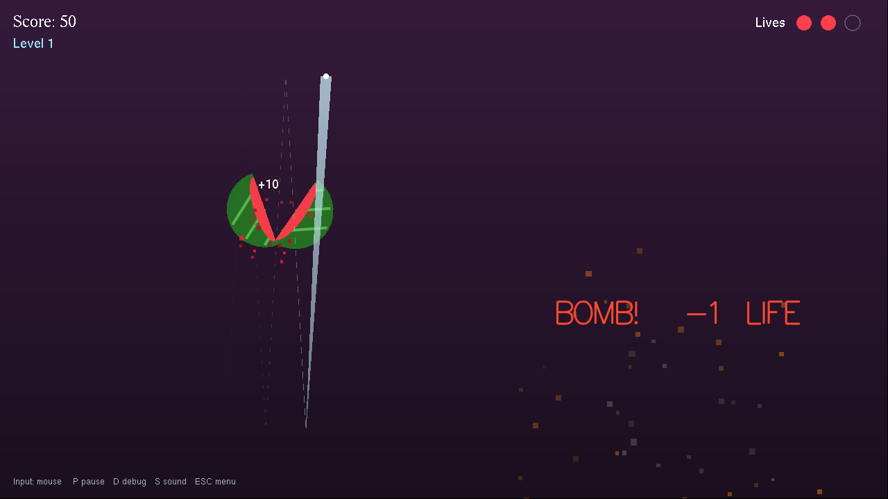

# AirSlice

**A webcam-controlled fruit-slicing game built with OpenGL and real-time colour tracking.**

Wave a brightly coloured object (a green pen, a strip of coloured paper on your fingertip) in front of your webcam, and a glowing blade follows it across the screen. Slice the fruit, avoid the bombs, and chain cuts for combo bonuses. A mouse mode is included for testing and for poor lighting.

> CSE 402 · Computer Graphics & Image Processing Lab ·
> Team: **Suheb & Ferdus**

## Download and play

**[⬇ Download AirSlice for Windows (v1.0)](https://github.com/shuyeb00/AirSlice/releases/download/v1.0/AirSlice-v1.0-Windows.zip)** (81 MB)

1. Extract the zip.
2. Double-click `AirSlice.exe`. No installation is needed.
3. Press **M** to play with the mouse, or **W** to play with a webcam and a green object.

If Windows shows *"Windows protected your PC"*, click **More info → Run anyway**. This appears because the app is not code-signed.

---

## Screenshots

| Menu | Slicing |
|---|---|
|  |  |



---

## Features

- **Webcam control.** A classical image processing pipeline tracks a coloured marker in real time on its own thread.
- **Mouse mode.** The same game logic runs with the mouse, so the game is playable without a camera.
- **Cutting.**
  - Fruit split into two rotating halves with the inside showing.
  - Juice particles burst from every cut.
  - A fading blade trail follows the marker.
- **Game rules.**
  - Four fruit types and bombs.
  - Score, plus a combo bonus for 3 or more fruit cut in one swipe.
  - Three lives and ten difficulty levels.
  - A saved high score.
- **Calibration.**
  - One-key colour calibration, plus Green / Purple / Pink presets.
  - A live binary-mask view to check the tracking.
- **Sound effects.** Seven effects, all generated in code, so no audio files are needed.
- **Screens and window.**
  - Menu, webcam setup, pause and game-over screens.
  - A letterboxed 16:9 view that keeps shapes round at any window size.

---

## Controls

| Key | Menu | Webcam setup | Playing |
|---|---|---|---|
| `W` | Play with webcam | | |
| `M` | Play with mouse | | |
| `C` | | Calibrate to the object in the yellow box | |
| `1` `2` `3` | | Green / Purple / Pink preset | Switch preset |
| `D` | | Show binary mask | Debug info |
| `V` | | | Show / hide camera preview |
| `P` / `Space` | | Start game (`Space`) | Pause / resume |
| `S` | Sound on / off | Sound on / off | Sound on / off |
| `Esc` | Quit | Back to menu | Back to menu |

On the game-over screen, `Space` plays again and `M` returns to the menu.

**Tips for webcam mode**

- **Lighting.** Play in a bright room. More light gives the camera a higher frame rate and less motion blur.
- **Marker colour.** Green works best. Avoid red, orange and pink markers, which are close to skin colour.
- **Background.** Avoid wearing or standing in front of the marker's colour.
- **Check the mask.** Press `D` on the setup screen. The marker should be a clean white blob, with everything else black.

---

## How it works

### Image processing pipeline (`Vision.cpp`)

Each camera frame passes through these steps on a background thread:

1. **Capture and mirror.** The frame is flipped horizontally, so moving your hand right moves the blade right.
2. **Gaussian blur (5×5).** Removes sensor noise.
3. **BGR → HSV conversion.** Separates colour (hue) from brightness, so the tracking is less sensitive to lighting.
4. **Colour thresholding.** Pixels inside the HSV range become white; this is the binary mask.
5. **Morphological opening, then dilation.** Opening removes isolated specks; dilation fills small holes.
6. **Contour extraction.** The largest contour above a minimum area is kept as the marker.
7. **Centroid from polygon moments.** The area comes from the shoelace formula, and the centroid is M₁₀/M₀₀, M₀₁/M₀₀.
8. **Exponential moving average.** Smooths the position over time, which reduces jitter.

**Calibration.** The player holds the marker in the yellow box and presses `C`.
- The game reads the most saturated quarter of the pixels in the box. This ignores skin or background around a small object.
- It takes a circular mean of their hue, because hue is an angle and wraps around.
- It builds the HSV range from that hue.

### Computer graphics techniques

| Technique | Where it is used |
|---|---|
| 2D primitives (triangle fans, quads, line strips) | Fruit, bombs, HUD, background |
| Orthographic projection | Fixed 1280 × 720 world, independent of window size |
| Translation, rotation, scaling | Spinning fruit, flying halves, ellipses, pop-up text |
| Projectile motion (semi-implicit Euler, delta time) | Fruit launched in parabolic arcs; launch speed from v = √(2gh) |
| Line-segment / circle intersection | Detecting a cut |
| Clip planes | Drawing each half of a cut fruit |
| Alpha blending | Blade trail, particles, overlays, red bomb flash |
| Particle system | Juice and explosion effects |
| Texture mapping | Live camera image and mask shown inside the game |
| Window-to-viewport transformation | Mouse and camera coordinates mapped to the world; letterboxing |
| Double buffering | Flicker-free animation at about 60 FPS |
| Stroke fonts | Scalable title and animated pop-up text |

---

## Project structure

```
AirSlice/
├── main.cpp      Window, game loop, screens, input, HUD, camera preview
├── Game.h/.cpp   Fruit, bombs, physics, cutting, particles, score and lives
├── Vision.h/.cpp Camera thread and colour-tracking pipeline
├── Sound.h/.cpp  Generated sound effects (Windows waveOut)
├── Draw.h/.cpp   Drawing helpers: shapes, text, background
├── Config.h      World size and constants
└── tests/        Toolchain test programs used during setup
```

---

## Building and running

### Requirements

- Windows 10 or later, with a webcam (needed only for webcam mode)
- [MSYS2](https://www.msys2.org), installed to `C:\msys64`
- Code::Blocks

### 1. Install the compiler and libraries

Open the **MSYS2 UCRT64** terminal and run:

```bash
pacman -Syu
pacman -S --needed mingw-w64-ucrt-x86_64-gcc mingw-w64-ucrt-x86_64-pkgconf \
                   mingw-w64-ucrt-x86_64-opencv mingw-w64-ucrt-x86_64-freeglut
```

### 2. Add the compiler to Code::Blocks

1. **Settings → Compiler** → copy *GNU GCC Compiler* → name the copy `MSYS2 UCRT64 GCC`.
2. On the **Toolchain executables** tab, set:
   - *Compiler's installation directory:* `C:\msys64\ucrt64`
   - C compiler: `gcc.exe`; C++ compiler: `g++.exe`; linker: `g++.exe`
3. On the **Additional Paths** tab, add `C:\msys64\ucrt64\bin`.

### 3. Project build options

Open `AirSlice.cbp`, select the `MSYS2 UCRT64 GCC` compiler, then set:

| Setting | Value |
|---|---|
| Compiler settings → Other options | `-std=c++17 -Wall` |
| Search directories → Compiler | `C:\msys64\ucrt64\include\opencv5` |
| Linker settings → Other linker options | `-lfreeglut -lopengl32 -lglu32 -lopencv_core -lopencv_imgproc -lopencv_videoio -lwinmm` |

### 4. Build and run

Press **Ctrl+F11** (Rebuild). Wait for *Build finished*, then press **Ctrl+F10** (Run).

### Running the .exe outside Code::Blocks

The executable needs the MSYS2 DLLs next to it. To copy them, open the **MSYS2 UCRT64** terminal in the folder that holds `AirSlice.exe` and run:

```bash
ldd AirSlice.exe | grep -i ucrt64 | awk '{print $3}' | xargs -I{} cp {} .
```

The folder can then be zipped and run on any Windows PC without installing anything.

---

## Known limitations

- **Marker colour.** Tracking needs a brightly coloured marker; a bare hand is not tracked, because no machine-learning model is used.
- **Lighting and background.** Results depend on both. An object of the same colour in view can confuse the tracker.
- **Camera frame rate.** The rate (typically 20–30 FPS) limits how fast the blade can follow very quick swipes.
- **Platform.** Sound is Windows-only; on other systems the game runs silently.